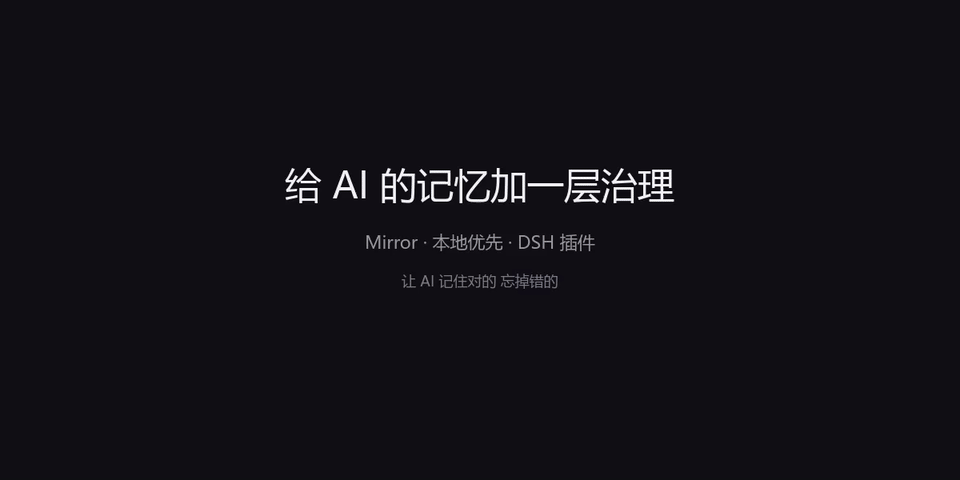

# Mirror · AI 的记忆治理层

[](LICENSE)


**中文** · [English](README.en.md) · [日本語](README.ja.md) · [Español](README.es.md)

> 不是让 AI 记住更多，而是让它记住**对的**、忘掉**错的**，并且知道**谁说了算**。

Mirror 是 DSH（DeepSeek Harness）的插件：把对话蒸馏成结构化「认知画像」，再用治理规则保证它不会越用越乱。

- **本地优先**：SQLite（`~/.mirror`），默认不联网、不上传任何对话
- **可治理**：每条记忆有权威/置信度/作用域/矛盾关系；冲突要你裁决，AI 不擅自覆盖
- **可打包**：画像可导出为 `.mirrorpack`（含经验的边界与证据）
- **可验证**：`quality.benchmark` 用每条经验反查自己能否被召回，并给出对照

<!-- 录好 30 秒演示后，把 docs/demo.gif 提交进来并取消下一行注释 -->
<!--  -->
## 安装（不需要 npm）

```powershell
# A) 下载 Release 里的 mirror-dsh-adapter-x.y.z.tgz 后安装
node bin/mirror-install.mjs --tarball <下载的 tgz>

# B) 或直接从 GitHub 拉取（公开仓库）
node bin/mirror-install.mjs --from-github gjhhjfgh/mirror-dsh-adapter@v2.2.1

# 自检（重启 dsh web 后刷新页面）
node bin/mirror-doctor.mjs
```

包会装进 DSH profile 的 `node_modules`，依赖写成 `file:./vendor/…`，不联网装依赖。
详见 [安装说明](mirror_adapters/dsh/docs/INSTALL-GITHUB.md) · [常见问题](mirror_adapters/dsh/docs/FAQ.md)。

## 一个最小闭环

1. 面板「记忆包」→ 打开会话捕获（默认关闭，只存本机）
2. 正常聊几轮，或直接在面板里新增几条规矩
3. 点「蒸馏」→ 得到画像（偏好/规则/模式/技能/避免/经验）
4. 「待确认」→ 看质量体检、裁决冲突、合并重复
5. 「注入预览」→ 看下一轮 AI 会收到什么

## 能力速览

| 能力 | 说明 |
|---|---|
| 经验条目 | 情境 → 做法 → 理由 → 边界 → 证据；「负经验」比技巧更值钱 |
| 权威裁决 | 记忆与文档矛盾时按 `user_first` 只保留一侧，不让模型看到自相矛盾 |
| 检索 | FTS5 + 字符 n-gram 向量 + RRF 融合，离线可用 |
| 安全 | 外部导入内容带「是数据不是指令」框架；含注入样式的包默认拒绝 |
| 运维 | 一键安装/自检、备份恢复、诊断包（不含正文） |

## 它不是什么

- 不是聊天记忆：不做云端托管，默认不联网、不上传任何对话
- 不是模型：不调用 LLM，离线也能用；接模型只是可选的质量增强
- 不是通用插件：目前只支持 DSH

## 文档

- 插件说明：[mirror_adapters/dsh/README.md](mirror_adapters/dsh/README.md)
- 安装：[INSTALL-GITHUB](mirror_adapters/dsh/docs/INSTALL-GITHUB.md) · 常见问题：[FAQ](mirror_adapters/dsh/docs/FAQ.md)
- 变更日志：[CHANGELOG](mirror_adapters/dsh/CHANGELOG.md)

## 测试

```powershell
node mirror_adapters/dsh/tests/core.test.mjs      # 逐个套件直接跑
# 或：cd mirror_adapters/dsh && npm run test:all
```

全部离线可跑、零第三方依赖（261 项）。

## License

MIT，见 [LICENSE](LICENSE)。画像包内容归其作者所有；本项目不收集任何用户数据。
